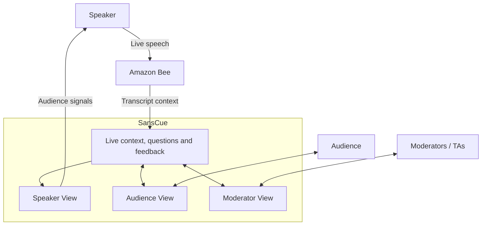

# SansCue

**AI has made it possible to personalize information at scale. We want to make communication more personal at scale, too.**

SansCue is a context-aware communication platform. It uses Bee’s live
conversational context to help audiences participate through relevant
check-ins, feedback, and private questions—and help speakers and moderators
respond to what people need.

Our first implementation focuses on the speaker-and-audience environment.
The larger goal is to make one-to-many human communication more interactive,
understandable, and responsive to individual needs.

Built for the Bee track of the
[Build, Ship, Shape: Amazon Developer Hackathon](https://amazonappdev2026.devpost.com/).

## Contents

- [Why we built SansCue](#why-we-built-sanscue)
- [The experience](#the-experience)
- [The larger vision](#the-larger-vision)
- [Try it](#try-it)
- [Architecture](#architecture)
- [Find your way around the code](#find-your-way-around-the-code)
- [Evidence and data handling](#evidence-and-data-handling)
- [The team and how we built it](#the-team-and-how-we-built-it)

## Why we built SansCue

A speaker can address hundreds or thousands of people at once. Understanding
those people individually is much harder.

Every listener brings different knowledge, questions, confidence, and processing
needs. Some want another explanation. Some have a useful insight but never reach
the microphone. Some are uncomfortable asking a question in front of everyone.
Yet the speaker hears from only a small part of the room. A shared presentation
can leave individual needs invisible.

Raised hands, a short Q&A period, and a digital question box provide ways to
participate. The opportunity we saw was to connect participation with the
conversation itself. “Why does that happen?” means much more when you know what
the person was reacting to.

Bee provides continuous spoken context. SansCue uses that context to prepare
interactions relevant to the discussion, gather many responses at once, and
give people a private place for questions that need individual attention.
The speaker gains information to act on; audience members gain a way to be
heard while the session is still happening.

## The experience

SansCue keeps three perspectives connected within one room:

| Perspective | What it enables |
| --- | --- |
| **Speaker** | See topic feedback, response counts, the live transcript, generated drafts, and audience Q&A; decide whether to clarify, revisit, answer aloud, or continue. |
| **Audience** | Join by link or QR code, respond to the current check-in, and ask private written questions without taking the microphone. No Bee account is needed. |
| **Moderator / TA** | Review, edit, dismiss, and publish generated check-ins; read the transcript and response dashboard; reply privately to audience questions. |

### A small response can make a need visible

After the speaker explains an idea, AI can draft a short clarity check-in with
a supporting transcript quote. A moderator reviews it and chooses its topic
before publication. Listeners respond **Clear**, **Partly clear**, or **Need help**.

Someone who would never raise a hand can still contribute a quick response.
The speaker sees feedback by topic, alongside the number of people who
responded. This can help them decide what deserves another explanation.
The chart summarizes self-reported clarity; it does not establish what
everyone knows or tell the speaker what to do.

### Individual questions have their own channel

A shared signal cannot express every person's question. Audience members can
also submit written questions and receive moderator replies. Threads are saved
within the room and visible to their author and room staff.

When a check-in is active, a submitted question references it. This preserves
a connection to the topic being discussed. The current application does not
automatically attach a transcript passage to every written question.

### Moderators support the conversation

A moderator handles draft review and private replies while the speaker presents.
AI generates the check-in drafts automatically, but **only a moderator can
publish them**. The speaker can inspect drafts and Q&A; written replies are
currently sent by moderators. AI does not automatically answer audience questions.

Moderator control of generated drafts is implemented. Flagging or deleting
audience-submitted questions is not implemented in this release.

## The larger vision

We are starting with a room, a speaker, and an audience. The same communication
problem appears in conferences, classrooms, workshops, training sessions, and
public forums: one person can speak to many, but hearing back from each person
is difficult.

Personalization here means making different questions, reactions, and needs
visible enough for people to respond. It can improve the shared conversation
while preserving room for individual support. It does not require a separate
presentation for every person.

We want to explore richer links between speech and audience questions, better
ways to prioritize moderator work, and support suited to different settings.
Classroom tools such as captions, reviewable notes, and quizzes are possible
extensions. These are future directions, not current capabilities.

The next step is to validate whether the signals are useful, when participation
helps rather than distracts, and what privacy and operational requirements each
setting needs. Thousands of participants are part of the problem we want to
address, not a demonstrated capacity of this MVP.

## Try it

**Demo deployment:** [Open SansCue](https://184.193.80.255).
Availability follows the deployment schedule. Live speech depends on the team's
authenticated Bee connection on the presenter's computer.

Use separate browsers, browser profiles, or devices for the three roles:

1. Create a room as the speaker, invite a moderator, and share the audience
   link. Room creation requires open-demo mode or operator access.
2. Select the intended Bee recording and confirm speech reaches the transcript.
3. Explain a topic, review and publish a draft as the moderator, then respond
   as an audience member. Check the speaker dashboard and try a private Q&A reply.

For local installation, use the [setup guide](deploy/README.md).
The [synthetic acceptance guide](services/acceptance/README.md) exercises service
integration without Bee hardware, AWS, or a model provider.

## Architecture

We chose three separate Rust services so ingestion, model processing, and
audience interactions can evolve independently. Each owns a PostgreSQL 17 database.

| Service | Responsibility |
| --- | --- |
| **Bee connection** | Associate the selected recording with its room and deliver transcript events. |
| **Topics and questions** | Assemble recent speech, apply generation controls, call the model, and validate supporting quotes. |
| **Sessions** | Manage roles, publication, audience responses, private Q&A, and live browser updates. |

The browser app uses **Preact, TypeScript, and Vite**. **Docker Compose** runs the
hosted application on **Amazon EC2**, with **Caddy** providing HTTPS. An
authenticated Bee command-line tool and worker run on the trusted Mac, connected
to private EC2 endpoints through SSH tunnels.

The hosted model configuration uses **Amazon Bedrock Nova Micro**
(`amazon.nova-micro-v1:0`). Generation uses recent transcript windows and
context/cadence checks. Supporting quotes must match the transcript; a moderator
still judges whether the question is useful. Without model credentials, a
labeled deterministic placeholder supports development.

See [question generation](docs/question-generation-design.md) for defaults,
publication behavior, feedback scoring, and reliability controls.

## Find your way around the code

| Location | What to look for |
| --- | --- |
| [web/src/app/](web/src/app/) | Speaker, audience, and moderator interfaces |
| [services/sessions/src/](services/sessions/src/) | Room access, publication, feedback, and private replies |
| [services/bee-connection/](services/bee-connection/) | Live Bee ingestion and recording associations |
| [services/topics-and-questions/](services/topics-and-questions/) | Context windows and model integration |
| [services/acceptance/](services/acceptance/) | Synthetic integration checks |
| [deploy/README.md](deploy/README.md) | Local setup |
| [deploy/PRODUCTION.md](deploy/PRODUCTION.md) | EC2 deployment and operation |

## Evidence and data handling

Recorded checks establish local Apple Watch transcript delivery and, separately,
hosted Nova generation through audience feedback using synthetic speech.
The complete live-device-to-hosted-AI rehearsal, representative model quality,
and audience load remain unverified in that record. This is a single-host MVP.
See the [verification record](docs/environment-verification.md) for revisions
and scope.

Selected transcript excerpts are sent to the configured AI provider.
Transcripts, questions, and responses remain until the operator deletes them
and relevant backups. Ending a room stops participation and its recording
association; it does not delete data or stop the Bee device's recording.
Use consented speech for demonstrations. Institutional use needs further work
on consent, retention, access, and deletion.

## The team and how we built it

**Abhinesh Dahal and Sanskriti Poudel** built SansCue with coding-agent assistance.
Our work included product direction, integration, device testing, deployment,
and an AWS-hosted agent development environment. The
[development story](docs/development-story.md) explains that work and links
representative contributions. [Tool feedback](docs/product-feedback.md) records
our experience with Bee, Bedrock, and the development setup.

Licensed under the [MIT License](LICENSE).
