# SansCue: MVP Build Plan

We'll build the conference flow in steps. This is the initial scope, not every planned feature.

**Recommended stack:** Preact + TypeScript + Vite + CSS; Rust + Axum + Tokio; PostgreSQL + SQLx; Docker Compose on EC2 with Caddy HTTPS.

## Status — October 20, 2026

- **Step 1:** EC2/public HTTPS, health/readiness, database outage recovery and automatic recovery at the same IP after EC2 stop/start passed. Three database dumps restored with matching data hashes into temporary check databases on the same host. Off-instance disaster recovery and application rollback remain open; see the [EC2 runbook](../deploy/PRODUCTION.md).
- **Steps 2–6 and 10:** Implemented; synthetic acceptance is reported in PR #2. Hosted Nova acceptance passed for room creation, staff-only drafts, moderator publication, audience rating and dashboard privacy. Hosted reconnect and full device rehearsal remain open.
- **Step 7:** Live Apple Watch-to-room delivery is recorded in PR #2; speaker and TA transcript visibility is recorded in PR #3. Full identity/order, retry, recovery and binding-change runbook acceptance is not recorded.
- **Step 8:** Rolling transcript windows, provider generation, evidence validation, and moderator review are implemented. Bedrock Nova Micro is active on EC2; actual model-generated drafts passed the hosted synthetic-transcript flow on October 20. Earlier PR #3's Claude quota failure is historical. Live Bee-to-hosted-AI delivery remains to be rehearsed.
- **Step 9:** No completed two-model comparison is recorded. A provider integration alone does not select the model against quality, delay and cost targets.
- **Step 11:** Historical synthetic/service checks exist; release-revision load, full-flow latency, cost and recovery measurements remain open.

See [environment verification](environment-verification.md) for revisions and
reported versus locally executed checks. Older results remain useful within
their scope and do not need to be discarded.

**Hackathon deployment decision:** Visitors may create rooms immediately when
`SESSIONS_DEMO_OPEN_ROOMS=true`; each room's organizer authority belongs to its
creating browser session. Audience users still join normally. Production API
limits and private service networking protect the initial public deployment.
The first endpoint uses EC2's public IPv4 with HTTPS; a custom domain can come
later. Judging requires continuous availability November 9–20, 2026. Email
approval is deferred for this demo.

## Services

| Service | Owns |
|---|---|
| Sessions-and-feedback | Rooms, access, published questions, responses, and live updates |
| Bee-connection | Original transcript events and their room association |
| Topics-and-questions | Topic context, generation jobs, and generated questions with evidence references |

Each backend runs independently and owns its database. Services exchange data through authenticated APIs or messages, never by reading another service's database. The web app is the frontend.

Diagrams use short service names and show the main data flow through the components built so far. AWS hosting from Step 1 applies throughout.

## Step 1: Deploy the platform

**Build:**

1. Browser interface — **Preact + TypeScript + Vite + CSS**.
2. Backend and database — **Rust + Axum + Tokio, PostgreSQL + SQLx**. Keep numbered SQL changes for database setup and updates.
3. HTTPS deployment and server/database health checks — **EC2 + Docker Compose + Caddy**. Document configuration, persistent storage, backup, and restore.

**Service:** Sessions-and-feedback microservice and frontend setup.

**Success:** HTTPS page loads; backend and database checks pass.

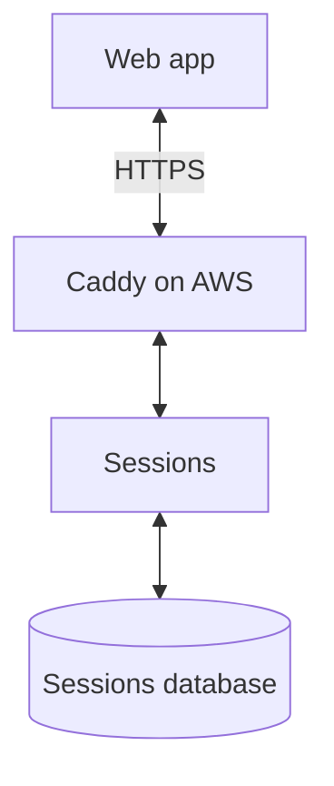

## Step 2: Create and join rooms

**Build:**

1. Create rooms and unique join links — **Axum + PostgreSQL**.
2. Display join links as QR codes — **qrcode**, loaded on the host screen.
3. Join rooms, save membership, and return current room state — **browser fetch + Axum + SQLx**.

**Service:** Sessions-and-feedback.

**Success:** Rooms persist; valid QR links join the correct room; invalid links return clear errors.

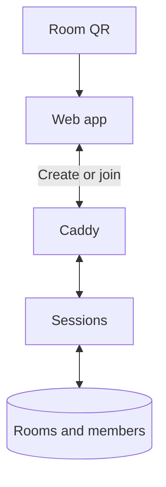

## Step 3: Control room access

**Build:**

1. Define speaker setup and TA invitations; issue and revoke access — **Axum + PostgreSQL**.
2. Remember room membership and permissions — **Secure HttpOnly session cookies** backed by database records.
3. Check room and role on protected requests; add origin and CSRF checks — **Axum**. Apply the same access rules to WebSockets in Step 5.

**Service:** Sessions-and-feedback.

**Success:** Protected actions require permission; changing a URL cannot grant another role's access.

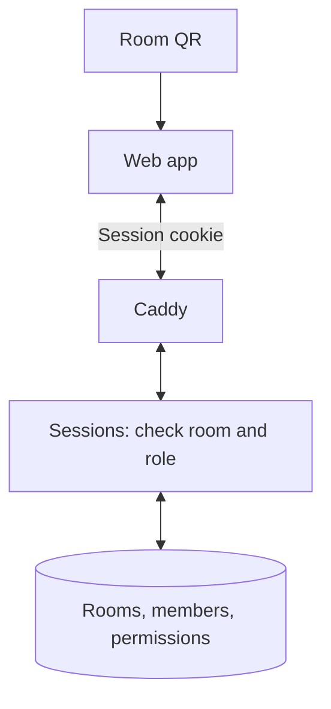

## Step 4: Build room tabs

**Build:**

1. Speaker dashboard, Questions view, and TA access to Questions — **Preact + CSS**.
2. Separate audience response and written Q&A tabs — **Preact**. Written-question entry belongs only in Q&A.
3. Navigation, room-status screens, and retained input when switching tabs — **browser History API + Preact state**.

**Service:** Frontend, using sessions-and-feedback.

**Success:** Tabs respect permissions and preserve unfinished input.

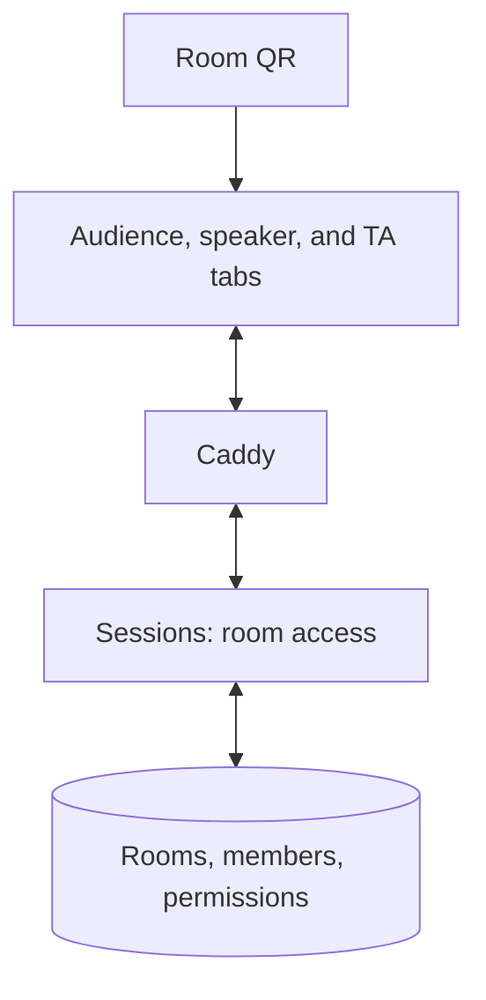

## Step 5: Send live updates

**Build:**

1. Browser connections grouped by room and permission — **Axum WebSockets + browser WebSocket API**.
2. Save changes before acknowledgement and broadcast; prevent repeated actions on retries — **SQLx transactions + request IDs**.
3. Define JSON events and limit outgoing queues for slow clients — **Serde + Tokio**. Record send/receive timings.

**Service:** Sessions-and-feedback.

**Success:** Updates reach permitted tabs without refresh; retries do not repeat saved actions.

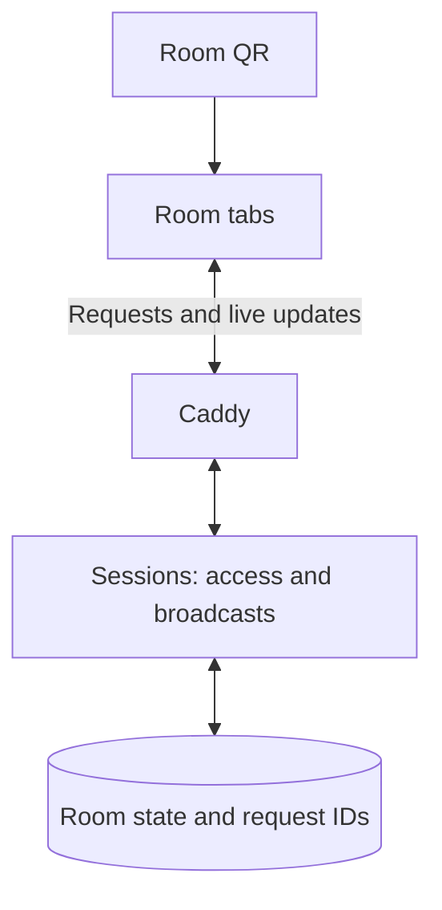

## Step 6: Reconnect and end rooms

**Build:**

1. Retry lost connections and restore membership — **browser WebSocket API + session cookies**.
2. Reload saved room state after reconnecting without missing changes during recovery — **Axum + SQLx + event ordering**.
3. End rooms, notify connected tabs, and reject further participation — **Axum + PostgreSQL + WebSockets**.

**Service:** Sessions-and-feedback.

**Success:** Reconnecting restores current state without duplicate membership; ended rooms reject participation.

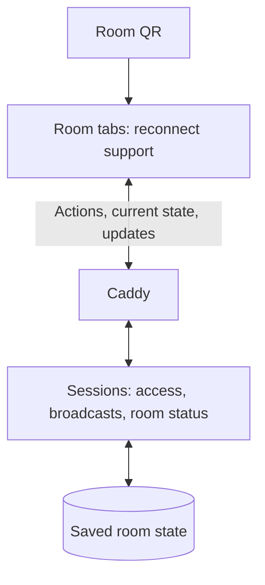

## Step 7: Connect Bee

**Build:**

1. Receive Bee transcript events and associate the conversation with a room — **Bee stream + Rust adapter**.
2. Preserve raw events, receive times, and arrival order — **PostgreSQL + SQLx**. Verify available source IDs and ordering information.
3. Handle reconnects and record gaps; verify how missed context can be recovered. Keep recorded events for repeatable integration tests.

**Service:** New Bee-connection microservice.

**Implemented and observed:** Canonical replay/storage, authenticated room
binding and transactional delivery, and an authenticated Bee CLI adapter exist.
[PR #2](https://github.com/DahalAb1/SansCue/pull/2) records a real Apple Watch
recording reaching its room and producing drafts on local Compose.
[PR #3](https://github.com/DahalAb1/SansCue/pull/3) records speaker/TA transcript
visibility. The parser also incorporates an observed Bee CLI 0.8.0 payload.

**Remaining acceptance:** Complete the identity/order, duplicate delivery,
disconnect/backfill, binding-change and cleanup scenarios in the
[device verification runbook](bee-device-verification.md), recording sanitized
results. The existing live reports do not claim every scenario passed.

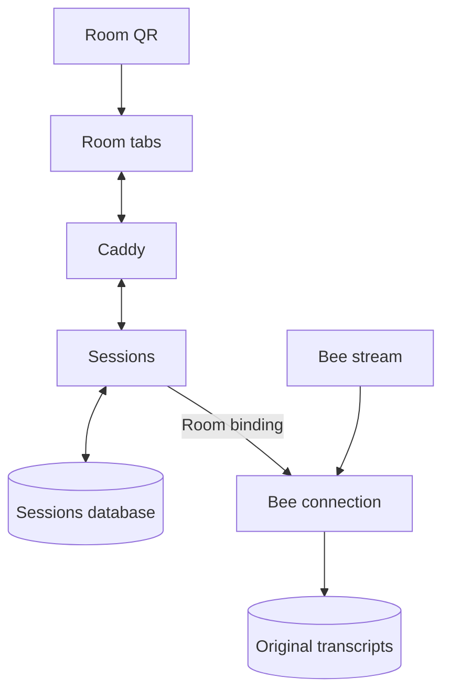

## Step 8: Generate a question

**Build:**

1. Decide an initial question format and topic-precision behavior when starting this step.
2. Process saved transcript jobs separately from audience requests — **Rust + PostgreSQL**, with retry IDs and authenticated service delivery.
3. Send recent passages and relevant earlier session context to a provisional model. Store the question, evidence references, model/prompt version, and generation time.
4. Display a generated candidate in a development preview — **Preact**. Keep publication and question frequency separate from topic precision.

**Service:** New topics-and-questions microservice; preview through sessions-and-feedback.

**Success:** A short question has traceable transcript evidence; slow generation leaves room updates responsive.

**Current implementation:** Topics processes speech-ordered rolling windows
with cadence, abstention and repeat suppression. It can call Claude through
Anthropic or Amazon Bedrock; without provider configuration it uses the explicit
`topic-window-stub-v1` placeholder. Generated evidence must match an exact source
excerpt. Jobs use leases, heartbeats, bounded retries, timeouts and fenced atomic
completion, followed by an authenticated candidate outbox. Sessions exposes
unpublished drafts only to staff; a moderator can edit and publish them.

**Recorded evidence and limits:** PR #2 reports live question drafts, without
identifying the generator. PR #3 records a real Bedrock request blocked by the
account's daily token limit, with no live AI draft observed. A successful live
provider draft, quality evaluation and release-revision responsiveness remain
to be recorded. Synthetic replay remains a separate, model-free check; see
[acceptance](../services/acceptance/README.md) and the
[design rationale](question-generation-design.md).

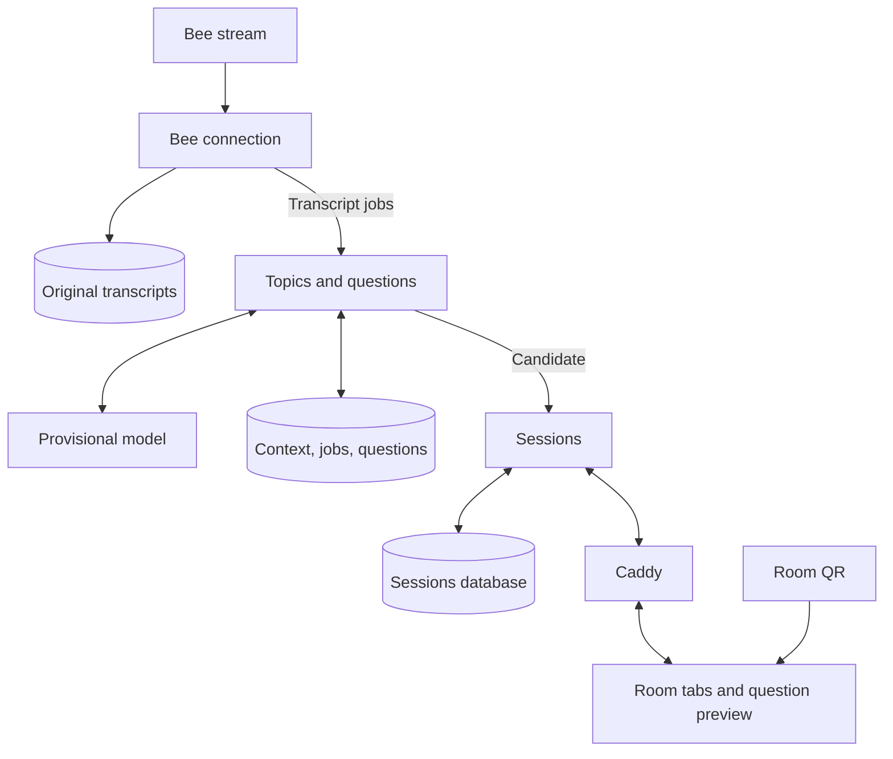

## Step 9: Choose the model

**Build:**

1. Set question-quality, generation-delay, and cost targets.
2. Compare two candidates using the same Bee excerpts and instructions.
3. Choose the model and record its exact ID, prompt, settings, and results. **Bedrock is a hosting candidate; provider and model remain undecided until evaluation.**

**Service:** Evaluation within topics-and-questions; no new microservice.

**Success:** A model is selected against recorded results; if neither meets the targets, revise and repeat.

Use the [model comparison worksheet](model-evaluation-worksheet.md) to freeze
the shared excerpts, prompts, targets, and scoring before generating outputs.
The worksheet is a template only; no completed provider comparison is recorded.
Bedrock connectivity was observed in PR #3, but that is not a model comparison.

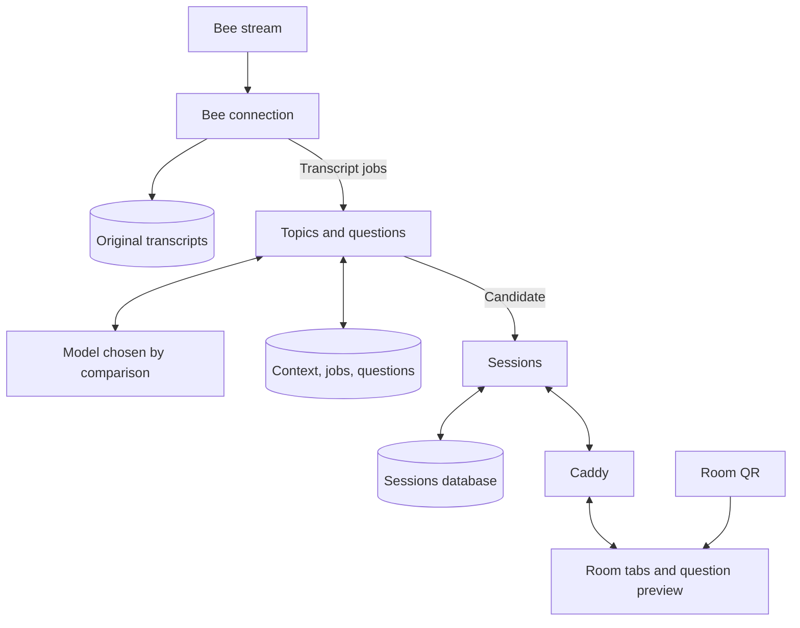

## Step 10: Collect responses and update the dashboard

**Build:**

1. Decide response controls, publication rules, written-Q&A behavior, and dashboard measures when starting this step.
2. Publish fixed question versions; retain evidence references and prevent late results from replacing an active question — **Axum + PostgreSQL**.
3. Save responses and context-linked written questions; send ratings and response counts to the dashboard — **SQLx + WebSockets + Preact**. Respect the chosen question type.

**Service:** Sessions-and-feedback and frontend; topics-and-questions supplies generated candidates.

**Success:** Published questions stay stable; saved responses produce correct counts and live dashboard updates.

**Current implementation:** Moderator (TA) publication copies evidence into an
immutable question version (see the [demo plan](live-feedback-demo-plan.md)); audience responses are idempotent and aggregate
counts/percentages are returned only to staff. Written Q&A is separate from
ratings and private to the audience author plus speaker/TAs. The frontend shows
counts and one-decimal percentages (an em dash for null percentages when there
are no respondents). This minimal flow does not establish load/performance.

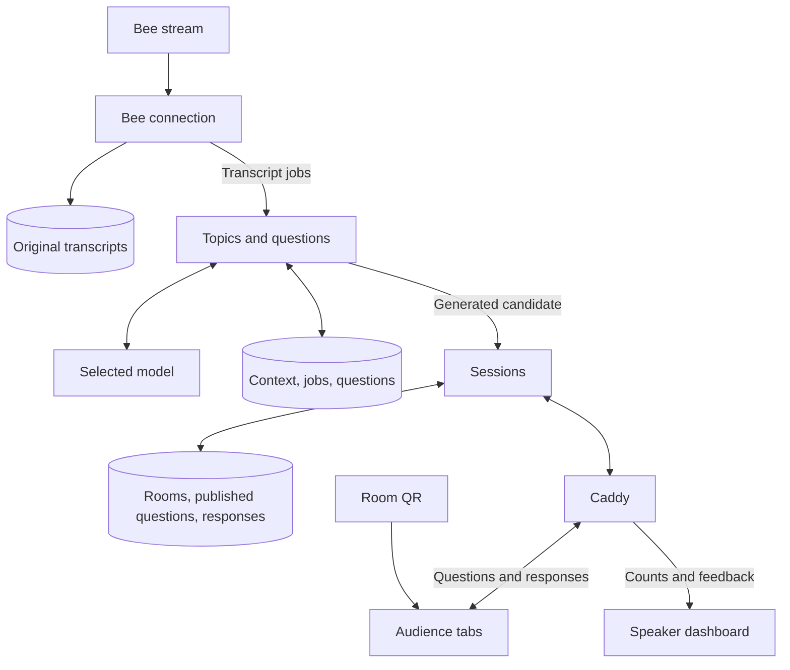

## Step 11: Check correctness and performance

**Build:**

1. Verify retries, duplicate/out-of-order events, disconnects, access checks, question stability, and response totals across services.
2. Agree on concurrent rooms, attendees, acceptable delays, and cost. Measure the full flow with actual Bee data, including median and 95th-percentile delays, errors, CPU, and memory.
3. Improve measured bottlenecks and retest. Choose server capacity from results; add replicas only with shared event delivery between them.

**Service:** All three microservices and frontend. Each step also gets its own checks during development.

**Hardware-independent acceptance procedure:**
[`services/acceptance/synthetic-mvp.py`](../services/acceptance/README.md) starts
the three local Rust services and Bee worker, replays the deterministic fixture,
then checks candidate idempotency, staff-only evidence, publication, audience
rating/Q&A, counts, and audience privacy using three distinct PostgreSQL DB URLs.
It requires neither Docker nor device/model/AWS access. This synthetic flow and
the service PostgreSQL suites have passed against the source tree integrated as
`dev` commit `411fba0`; see [environment verification](environment-verification.md)
for exact scope. Later live Watch/local Compose evidence is recorded in PRs #2 and #3; see
[environment verification](environment-verification.md). Full recovery, model
quality, AWS, performance, and backup/restore remain separate acceptance gates.

**Success:** The agreed workload meets correctness, delay, and cost targets.

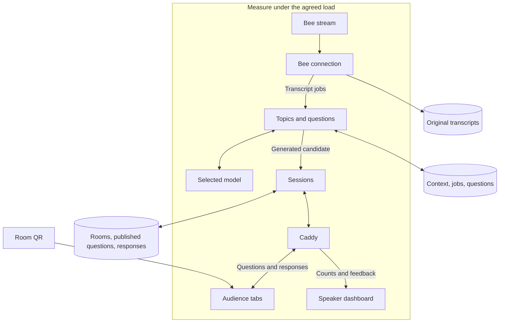

## Decisions for the relevant step

- **Before Step 7:** Bee event identity, ordering, gap recovery, and service delivery transport.
- **Before Step 8:** Question type, topic boundaries, precision, and context selection. Keep earlier context within the session; participant history across sessions is deferred.
- **Before Step 9:** Quality, delay, and cost targets for model comparison.
- **Before Step 10:** Response choices, publishing, frequency, timers, Q&A visibility/moderation, dashboard attention, and TA permissions.
- **Before Step 11:** Expected room sizes, simultaneous rooms, and performance targets.
